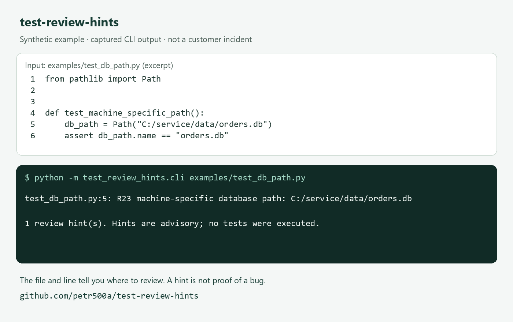

# test-review-hints

Find Windows database paths in Python tests without running the tests.

When reviewing an unfamiliar test suite, a path such as `C:/service/data/orders.db` is worth inspecting. This small local scanner points to the file and line so you can review it in context.

## See one example

The repository includes this **synthetic example** in `examples/test_db_path.py`:

```python
from pathlib import Path


def test_machine_specific_path():
    db_path = Path("C:/service/data/orders.db")
    assert db_path.name == "orders.db"
```

Running the scanner on that file produces:

```text
test_db_path.py:5: R23 machine-specific database path: C:/service/data/orders.db

1 review hint(s). Hints are advisory; no tests were executed.
```

The path may be intentional. The hint tells you where to look; it does not prove that the test is wrong or that the rest of the suite is safe to run.



## Try it

You need **Python 3.11 or newer** and Git for the commands below. No signup, API key or model is required.

```sh
git clone https://github.com/petr500a/test-review-hints.git
cd test-review-hints
python -m test_review_hints.cli examples/test_db_path.py
```

You can also use GitHub's **Code → Download ZIP**, extract it and run the last command from the extracted folder.

To inspect your own tests, stay in this folder and replace the example path with the actual path to your test directory:

```sh
python -m test_review_hints.cli "C:/path/to/your/project/tests"
```

On Linux/macOS, use your actual filesystem path. The scanner runs there too; the database-path rule currently detects Windows drive-letter paths, not POSIX or UNC paths.

## What it checks

| Hint | Enabled by default | Scope |
|---|---|---|
| R23: machine-specific database path | Yes | Windows drive-letter paths in test source files; fixture/temp markers are excluded |
| RD: unreachable statement | Yes | Statements directly after an unconditional return/raise in a function body; nested control flow is not analyzed |
| R43: producer/reader methods | No | Method-name heuristic in test functions; valid transport tests can trigger it |

To try the optional hint:

```sh
python -m test_review_hints.cli --include-boundary-hints examples
```

The included `test_boundary.py` is a valid transport test that triggers R43. It demonstrates why context matters.

## Interpreting the result

- Exit **0**: the scan completed, with or without hints.
- Exit **2**: the scan is incomplete because of an input, read, encoding or syntax error. Other readable files are still checked.
- No hints means no covered patterns were detected. It does not establish correctness or safety.

Directories are scanned recursively, excluding `.git`, `.venv` and `__pycache__`. Multiple paths and Python source encoding declarations are supported. Overlapping files are checked once.

## Local processing

The scanner reads source files. It does not run inspected code, open databases, modify your project or upload source code. Filenames and matching path literals appear in the local output, so check it before sharing.

This is an early tool with a few narrow checks. Keep using your normal linter and test runner. There is no PyPI package and no paid plan.

## Feedback

Did a hint help, or was it noise? A short [issue](https://github.com/petr500a/test-review-hints/issues) is welcome. For a reproducible bug, add your command, Python/OS versions and a small sanitized example if you can. Never upload databases, credentials or private source code.

## Optional command-line installation

From the downloaded repository:

```sh
python -m pip install .
test-review-hints "C:/path/to/your/project/tests"
```

## License

MIT. See [LICENSE](LICENSE).
